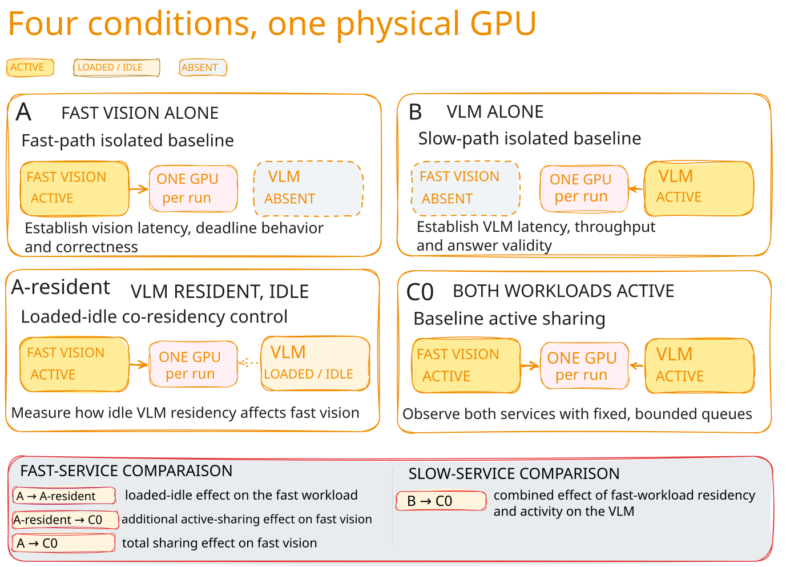

# Can Two Inference Workloads Share One GPU? {#sec-r0a}

::: {.callout-note title="Planned · Development pilot"}
**Experiment:** EXP-001 / P0. **Status:** Planned. **Evidence class:** Development pilot.

:::

## Research question

Can a fast vision workload and a bounded vision-language model run correctly on one GPU, and how does active sharing affect the fast service beyond the cost of keeping both deployments resident?

### Proposed prediction and competing explanations

- **Candidate prediction:** activating the slow workload changes fast consumer-ready latency or temporal misses relative to the loaded-idle control.
- **Competing explanation:** most of the change is already present with the slow deployment loaded but idle.
- **Alternative or confound:** temperature, clock drift, CPU preprocessing, or CPU/GPU power sharing explains part of the difference or its run-order dependence.

(these are draft hypotheses)

## Background

The fast service repeatedly processes visual observations. The slow service answers a bounded image-conditioned question. Their useful output requirements may differ: an output can be correct yet late, or on time yet stale.

Keeping a model loaded consumes GPU memory and may introduce background runtime activity, even when no inference requests are active. Activating it introduces further work. Separating those conditions is the purpose of the resident-idle arm.

“Active” describes submitted workload. It does not demonstrate simultaneous kernel execution or a GPU scheduling mechanism.

## Experimental design

| Arm | Meaning | Research purpose |
|---|---|---|
| A | Fast vision workload running alone; no slow server | Establish fast-path baseline performance |
| B | VLM running alone; no fast workload deployment | Establish slow-path baseline performance |
| A-resident | Fast vision running while the same VLM deployment is loaded but idle | Measure loaded-idle co-residency effects on the fast path |
| C0 | Both workloads active on one GPU, with fixed bounded queue and initially one active slow request | Establish baseline sharing behavior for both services |

{#fig-pilot-arms fig-alt="Four planned arms: A has fast vision active and no VLM; B has the VLM active and no fast deployment; A-resident has fast vision active and the VLM resident but idle; C0 has both active. The fast and slow comparisons are labelled."}

### What each comparison establishes

@fig-pilot-arms maps the conditions. Compare outcomes for the same service, using the reference and comparison conditions below:

| Contrast | Service measured | Interpretation |
|---|---|---|
| A vs A-resident | Fast | Loaded-idle co-residency effect |
| A-resident vs C0 | Fast | Additional effect of activating the slow workload |
| A vs C0 | Fast | Total sharing effect relative to fast vision alone |
| B vs C0 | Slow | Combined effect of fast-workload residency and activity on the VLM |

## Methodology

The [measurement methodology](../methods/measurement-contract.qmd) owns shared definitions. This chapter owns the choices for this experiment.

### Choices to establish before execution

| Item | Current state |
|---|---|
| GPU, driver, and exact environment | To be established |
| Fast task, model, and correctness scorer | To be selected and checked on permitted inputs |
| VLM task, serving runtime, and scorer | To be selected and pinned separately; check image sensitivity as well as the answer |
| Inputs and preprocessing | To be fixed; retain input identity and separate development inputs from future retained evaluation |
| Period, deadline, freshness threshold, and quality floor | To be declared with a task rationale or an explicit synthetic-stress label |
| Effective slow allocation and fast-path memory headroom | To be measured and recorded. Keep the slow allocation the same in B, A-resident, and C0 |
| Arrival, queue, duration, and drain contract | To be implemented and bounded before execution |

### Run discipline

We keep each service's inputs and externally offered load fixed across its applicable arms. Pre-create scheduled job identities and preserve outcomes for failed, dropped, unreleased, and unfinished work.

We use declared warmup, interleaved arms, and repeated-arm checks for drift. Keep power mode and charger state consistent; record display GPU use, other clients, temperatures, clocks, and telemetry gaps. Begin underloaded. Any load exploration changes one declared factor at a time.

After a bounded failed attempt, we preserve the error and narrow one justified factor. A failed/blocked attempt remains part of the record.

## Results

Not yet available, experiment not executed.

## Interpretation and limitations

Not yet available, interpretation will be added after execution and validity checks.

This development pilot tests one GPU, one workload pair, and one operating configuration. Its findings will be exploratory and specific to those conditions, without establishing latency guarantees or performance on other devices.

The comparisons distinguish loaded-idle co-residency from added slow-workload activity for the fast service. Identifying the underlying compute, memory, scheduling, or thermal/power mechanism requires additional evidence.

## Decision and next test

**Decision: Pending**

- **PROCEED:**
- **REVISE:**
- **BLOCKED:**